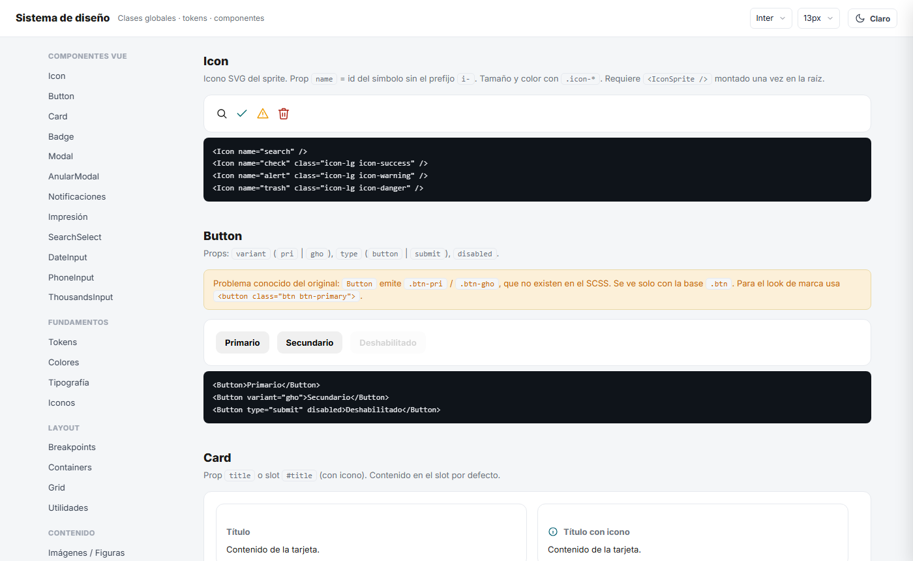
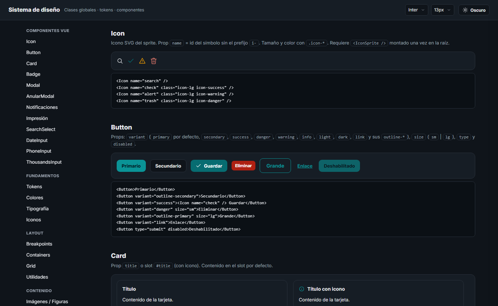

<div align="center">

# Vue Frontend Foundation

**Sistema de diseño SCSS, componentes globales y arquitectura base para proyectos Vue 3.**

Clona, ajusta la marca y empieza a construir: sin librerías visuales externas y con todo el estilo controlado por tokens.


[](LICENSE)

</div>

<p align="center">
  
  
</p>

---

## Contenido

- [¿Qué es?](#qué-es)
- [Características](#características)
- [Paleta](#paleta)
- [Inicio rápido](#inicio-rápido)
- [Usarlo en un proyecto nuevo](#usarlo-en-un-proyecto-nuevo)
- [Estilos](#estilos)
- [Componentes](#componentes)
- [Tema y marca](#tema-y-marca)
- [Estructura del repositorio](#estructura-del-repositorio)
- [Documentación](#documentación)
- [Convenciones](#convenciones)
- [Estado del proyecto](#estado-del-proyecto)
- [Licencia](#licencia)

---

## ¿Qué es?

Una base reutilizable para arrancar aplicaciones Vue 3 sin rehacer lo mismo en cada proyecto:

| Pieza | Qué incluye |
|---|---|
| 🎨 **Sistema de diseño** | Paleta de marca, tokens claro/oscuro, grid de 12 columnas, utilidades y unos 40 parciales de componentes en SCSS propio. |
| 🧩 **Componentes Vue** | 13 componentes globales (modal, selects, campo de fecha con selector propio, notificaciones, impresión…) más sus composables. |
| 📚 **Catálogo** | Una página con todos los componentes en vivo y su código, una sección por componente. |

**El problema que resuelve:** cada proyecto nuevo empezaba con los mismos botones, formularios, modales y colores escritos a mano. Aquí ya están resueltos, son coherentes entre sí y se personalizan desde un solo lugar.

---

## Características

- **Todo por tokens.** Ningún parcial usa colores escritos a mano: todo sale de variables CSS. Para cambiar de marca se cambia la paleta.
- **Modo claro y oscuro** con `useTheme()`. El tema se aplica antes del primer render, así que la página no parpadea al cargar.
- **Grid y utilidades propias:** `.row` / `.col-md-6`, `d-flex`, `gap-*`, `mt-*`, `text-*`, `bg-*`, `shadow-*` y más. Son mobile-first, con los breakpoints sm · md · lg · xl · xxl.
- **Formularios acabados:** estados de hover y foco, anillo de marca, selects con chevron propio y lista desplegable con diseño en Chrome y Edge 135 o superior (en Firefox y Safari la lista es la nativa). Los campos de fecha tienen un selector propio.
- **Patrones listos para documentación y paneles:** página con índice lateral, bloque de código con copiar, rejilla automática y muestras de color.
- **Dos puntos de entrada:** `main.scss` (completo) y `core.scss` (solo el núcleo genérico).
- **Internacionalización:** los componentes tienen textos en español, inglés, francés, portugués (Brasil) y chino, y las fechas y números se formatean según el idioma activo.
- **TypeScript estricto** y estado compartido con composables singleton, sin Pinia.

---

## Paleta

| | Token | Hex | Uso |
|---|---|---|---|
|  | `--brand-ink` | `#001219` | Texto oscuro, paneles, tooltips |
|  | `--brand-deep` | `#005F73` | **Primario** |
|  | `--brand-teal` | `#0A9396` | Éxito · primario en oscuro |
|  | `--brand-mint` | `#94D2BD` | Éxito suave |
|  | `--brand-sand` | `#E9D8A6` | Fondos cálidos, selección |
|  | `--brand-amber` | `#EE9B00` | Acento y aviso |
|  | `--brand-ochre` | `#CA6702` | Texto de aviso |
|  | `--brand-rust` | `#BB3E03` | Aviso fuerte |
|  | `--brand-red` | `#AE2012` | Peligro |
|  | `--brand-wine` | `#9B2226` | Peligro fuerte |

Las escalas de estado (`--success-*`, `--danger-*`, `--warning-*`, `--info-*`) y los tintes del primario se derivan de estos 10 colores en [`themes/_palette.scss`](src/styles/themes/_palette.scss).

---

## Inicio rápido

**Requisitos:** Node.js 18 o superior (probado con Node 22) y npm.

```bash
git clone https://github.com/Reina-rq/vue-frontend-foundation.git
cd vue-frontend-foundation
npm install
npm run dev          # catálogo en http://localhost:3000
```

| Script | Qué hace |
|---|---|
| `npm run dev` | Servidor de desarrollo con el catálogo (puerto 3000). |
| `npm run build` | Comprobación de tipos (`vue-tsc`) y build de producción. |
| `npm run preview` | Sirve el build de producción. |
| `npm run type-check` | Solo la comprobación de tipos. |

> En el catálogo puedes forzar el tema con `?theme=dark` o `?theme=light`, y probar fuentes y tamaños desde la barra superior.

---

## Usarlo en un proyecto nuevo

### Opción A · Como plantilla (recomendada)

1. Clona el repositorio o descárgalo como ZIP.
2. Conserva `src/` (la fundación) y usa `examples/` como referencia, o bórrala.
3. Cambia el `"name"` en `package.json` y crea tu propio `src/main.ts` y `App.vue`.

### Opción B · Copiar la fundación a un proyecto Vite existente

Copia `src/components`, `src/store`, `src/app/i18n` y `src/styles` a tu proyecto. Después:

**1. Alias e inyección SCSS** en `vite.config.ts`. Los componentes importan con `@/` y `@app/`, y los tokens y mixins se inyectan en cada `<style lang="scss">`:

```ts
resolve: {
  alias: {
    '@': fileURLToPath(new URL('./src', import.meta.url)),
    '@app': fileURLToPath(new URL('./src/app', import.meta.url)),
    '@styles': fileURLToPath(new URL('./src/styles', import.meta.url)),
  },
},
css: {
  preprocessorOptions: {
    scss: { api: 'modern-compiler', additionalData: `@use "@styles/abstracts/_index.scss" as *;` },
  },
},
```

Añade los mismos alias en `paths` de `tsconfig.app.json`.

**2. Arranque** en `main.ts`:

```ts
import { createApp } from 'vue'
import App from './App.vue'
import { getI18n } from '@app/i18n'
import { installDateGlobals } from '@app/i18n/dates'
import { installNumberGlobals } from '@app/i18n/numbers'
import { useTheme } from '@/store/useTheme'
import '@styles/core.scss'            // o '@styles/main.scss' (incluye legacy)

useTheme().init()
const app = createApp(App)
app.use(getI18n)
installDateGlobals(app)
installNumberGlobals(app)
app.mount('#app')
```

**3. Hosts globales**, que se montan una sola vez en `App.vue`:

```vue
<script setup lang="ts">
import { IconSprite, NotificationHost, PrintDoc } from '@/components'
</script>

<template>
  <IconSprite />
  <RouterView />        <!-- o tu contenido -->
  <NotificationHost />
  <PrintDoc />
</template>
```

**4. Tema sin parpadeo:** este script va en `index.html`, antes del `<div id="app">`:

```html
<script>
  try { if (localStorage.getItem('theme') === 'dark') document.body.classList.add('dark') } catch (e) {}
</script>
```

**5. i18n propio (opcional):** los componentes leen la instancia `getI18n` de [`src/app/i18n/index.ts`](src/app/i18n/index.ts) y el namespace `componentes`. Añade tus namespaces a `messages` o sustituye ese archivo por tu instancia. Mantén el export `getI18n` y el namespace `componentes`.

---

## Estilos

```ts
import '@styles/core.scss'   // núcleo: tokens, temas, base, grid, utilidades y componentes genéricos
import '@styles/main.scss'   // completo: núcleo + patrones legacy
```

`main.scss` carga los parciales en este orden: **paleta → temas → base → layout → componentes → grid → helpers → utilidades → responsive**. Las utilidades van casi al final para ganar a los componentes.

Los **patrones legacy** son los que heredan nombres propios en vez de genéricos: navbar de aplicación, `.sec`, `.kpi`, `.ledger`, `.totals`, `.tabs`/`.tab`, `.act`, `.pager`, `.toolbar`… En el código van envueltos en `@if $legacy { … }` y en el catálogo llevan la etiqueta *legacy*.

```html
<div class="row g-3">
  <div class="col-12 col-md-6">
    <label class="form-label">Nombre</label>
    <input class="form-control" placeholder="Escribe…">
  </div>
  <div class="col-12 col-md-6 d-flex align-items-end gap-8">
    <button class="btn btn-primary">Guardar</button>
    <button class="btn btn-outline-secondary">Cancelar</button>
  </div>
</div>
```

---

## Componentes

Se importan desde el barrel `@/components`:

```ts
import { Modal, SearchSelect, DateInput } from '@/components'
```

| Componente | Para qué | API |
|---|---|---|
| `Icon` | Icono SVG del sprite (93 iconos) | `name` |
| `IconSprite` | Sprite de símbolos; se monta una vez | — |
| `Button` | Botón | `variant` (`primary` … `dark`, `link`, `outline-*`), `size` (`sm` · `lg`), `type`, `disabled` |
| `Card` | Tarjeta con título | `title` · slot `#title` |
| `Badge` | Etiqueta de estado | `tone` (`primary` … `dark`), `pill` |
| `Modal` | Diálogo | `v-model:open`, `title`, `size` (`sm` · `lg` · `xl`), `compact`, `contentClass` · slot `#footer` |
| `AnularModal` | Confirmación para anular un registro | `v-model:open`, `num` · evento `confirm` |
| `NotificationHost` | Pila de notificaciones | con `useNotify()` |
| `PrintDoc` | Visor de impresión | con `usePrintDoc()` |
| `SearchSelect` | Select con buscador | `v-model`, `options`, `valueKey`, `labelKey`, `searchKeys`, `placeholder` · slots `#option`, `#selected` |
| `DateInput` | Fecha escribible con selector propio | `v-model` (`yyyy-mm-dd`), `disabled`, `placeholder` |
| `PhoneInput` | Código de país + número | `v-model` (`"+591 70000000"`) |
| `ThousandsInput` | Entero con separador de miles | `v-model` (solo dígitos) |

```ts
import { useNotify } from '@/store/useNotify'

const notify = useNotify()
notify.success('Guardado', 'El registro se guardó correctamente.')
```

En el [catálogo](#inicio-rápido) están todos los componentes en vivo, con sus props y su código.

---

## Tema y marca

| Quiero… | Dónde |
|---|---|
| Cambiar la marca | Los `--brand-*` en [`themes/_palette.scss`](src/styles/themes/_palette.scss) |
| Ajustar colores semánticos (`--color-primary`, `--color-text`…) | [`themes/_light.scss`](src/styles/themes/_light.scss) y [`themes/_dark.scss`](src/styles/themes/_dark.scss) |
| Cambiar fuente y tamaño base | `--font-family-base`, `--font-size-base` y `--line-height-base` en `_light.scss`; la fuente se carga en `index.html` |
| Alternar claro/oscuro desde código | `useTheme().toggle()` · `useTheme().set('dark')` |

Si el primario es oscuro, el texto encima es `--color-on-primary` (blanco por defecto en claro). En modo oscuro el primario pasa a `#0A9396` para mantener el contraste.

---

## Estructura del repositorio

```text
vue-frontend-foundation/
├── src/                          ← la fundación (lo que se reutiliza)
│   ├── components/               13 componentes + barrel index.ts
│   ├── store/                    useNotify · usePrintDoc · useTheme
│   ├── app/i18n/                 instancia i18n, fechas, números y textos (5 idiomas)
│   ├── styles/
│   │   ├── abstracts/            tokens SCSS, mixins, breakpoints, banderas (no emiten CSS)
│   │   ├── themes/               paleta, claro, oscuro
│   │   ├── base/                 reset, iconos, tablas, impresión, responsive
│   │   ├── layouts/              estructura de aplicación (legacy)
│   │   ├── components/           un parcial por componente
│   │   ├── grid/ helpers/ utilities/
│   │   ├── main.scss             entrada completa
│   │   └── core.scss             entrada núcleo
│   └── index.ts                  exportaciones públicas
├── examples/                     ← catálogo (no forma parte de la librería)
│   ├── pages/                    página del catálogo
│   ├── catalog/registry.ts       índice tipado de secciones
│   ├── layout/                   topbar, índice lateral, layout
│   ├── sections/                 una sección por componente
│   ├── demos/                    un .vue por ejemplo (el código mostrado sale de aquí)
│   └── components/ utils/        DemoBlock, DocSection, utilidades del catálogo
├── docs/                         documentación técnica y capturas
└── index.html · vite.config.ts · tsconfig*.json · package.json
```

---

## Documentación

| Documento | Contenido |
|---|---|
| [ARCHITECTURE.md](docs/ARCHITECTURE.md) | Capas, dependencias en un solo sentido, módulos, flujo de datos, nombres y alias |
| [DESIGN-SYSTEM.md](docs/DESIGN-SYSTEM.md) | Organización SCSS, orden de carga, tokens, utilidades, patrones, formularios y tablas |
| [COMPONENTS.md](docs/COMPONENTS.md) | Catálogo de componentes: props, eventos, slots, dependencias y ejemplos |
| [STYLING-RULES.md](docs/STYLING-RULES.md) | Convenciones de clases, variables, SCSS y estilos inline |
| [RESPONSIVE-DESIGN.md](docs/RESPONSIVE-DESIGN.md) | Breakpoints, contenedores, grid, gutters y adaptaciones |
| [THEMING.md](docs/THEMING.md) | Tokens, claro/oscuro, cambio de tema, marca y carga sin parpadeo |
| [DEVELOPMENT-GUIDELINES.md](docs/DEVELOPMENT-GUIDELINES.md) | TypeScript, SOLID, composables, HTTP, validación, i18n y errores |
| [DEPENDENCIES.md](docs/DEPENDENCIES.md) | Dependencias, versiones probadas, requisitos y compatibilidad |

---

## Convenciones

- **El markup va siempre en `<template>`.** Nunca HTML como texto dentro de `<script>`.
- **Sin `style="…"` estáticos.** Se usan clases globales y tokens; `:style` solo para valores que dependen de datos.
- **Colores siempre por variable** (`var(--color-*)` o `var(--brand-*)`), nunca hex directos en parciales.
- **Componentes pequeños, con una responsabilidad.** El estado compartido va en composables singleton (`src/store`).
- **Textos visibles por i18n** (`$t('componentes.…')`).
- **Fechas con `<DateInput>`**: el calendario de `<input type="date">` lo dibuja el navegador y no admite diseño.

---

## Estado del proyecto

- [x] Sistema de diseño con paleta de marca y tokens claro/oscuro
- [x] Componentes globales y catálogo por componente
- [x] `Button` con todas las variantes y tamaños del sistema
- [x] Catálogo construido solo con clases del sistema (sin CSS propio)
- [x] Documentación técnica en `docs/`
- [x] Licencia MIT

---

## Licencia

Distribuido bajo la licencia **MIT**. Puedes usar, copiar, modificar y distribuir el código, también en proyectos comerciales, siempre que conserves el aviso de copyright. Ver [LICENSE](LICENSE).

© 2026 Liz Reina

---

<div align="center">

Hecho con Vue 3 · TypeScript · SCSS

</div>
